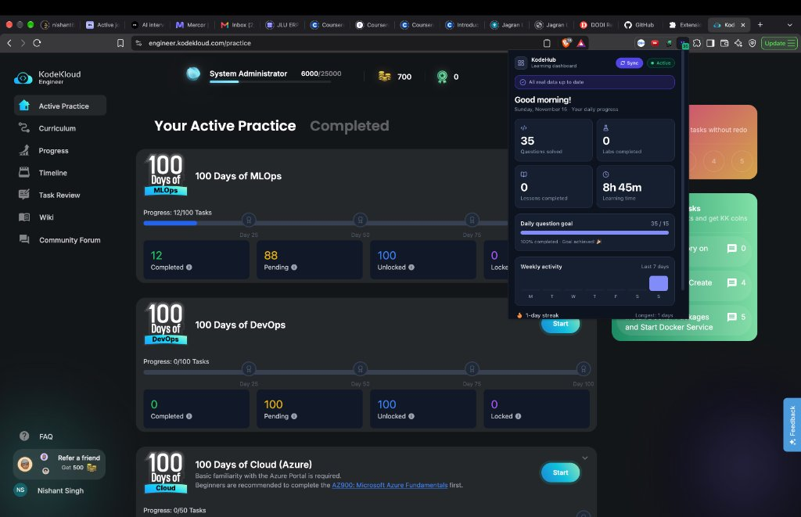
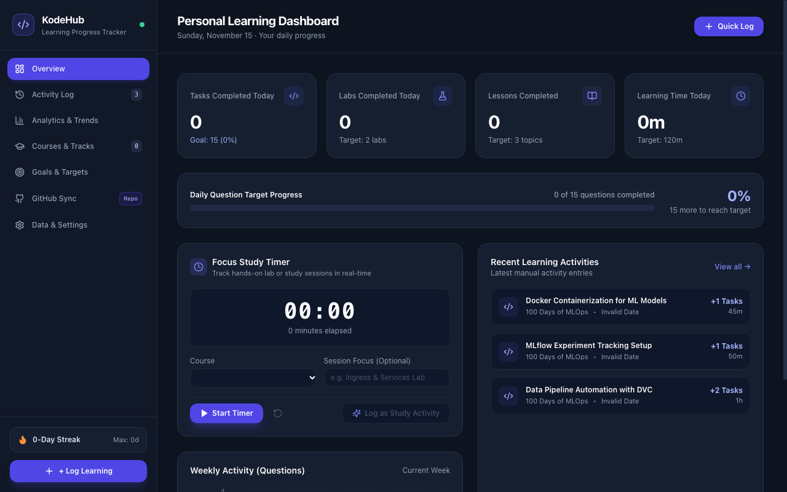
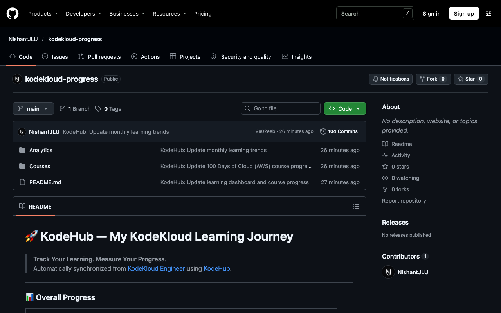

🚀 KodeHub

Track Your Learning. Measure Your Progress. Sync Directly to GitHub.

KodeHub is a Chrome Extension built for KodeKloud learners who want to track their learning journey, monitor daily achievements, visualize progress and automatically maintain a learning portfolio on GitHub.

It combines real-time course progress tracking, learning analytics, activity history and LeetHub-style GitHub synchronization in one lightweight developer tool.

  

  
  
  
  

⸻

📖 Table of Contents

* Overview
* Screenshots
* Features
* How It Works
* GitHub Integration
* Installation
* Configuration
* Project Structure
* Technology Stack
* Testing
* Privacy and Data Handling
* Roadmap
* Contributing
* License
* Author

⸻

🌟 Overview

Learning platforms provide course completion statistics, but maintaining a consistent record of daily learning activity and achievements across multiple courses can be difficult.

KodeHub addresses this by automatically tracking learning progress on KodeKloud Engineer and transforming it into structured, measurable learning analytics.

Whether you’re working through 100 Days of MLOps, 100 Days of DevOps or Cloud certifications, KodeHub helps you understand:

* How many tasks you’ve completed.
* How much progress you’ve made today.
* How consistently you’ve been learning.
* Which courses you’re actively working on.
* How your learning activity changes over time.

It also synchronizes your progress with GitHub, allowing you to maintain a structured and accessible record of your learning journey.

Supported platform: KodeKloud Engineer

⸻

📸 Screenshots

1. Extension Popup

A quick overview of daily learning activity, completed tasks, daily goals, learning time and weekly progress.

  

2. Full-Screen Dashboard

A detailed learning dashboard featuring activity history, analytics, learning trends and progress visualization.

  

3. Learning Analytics

Visualize your learning consistency through contribution heatmaps, weekly activity charts, course distribution and learning streaks.

  

4. GitHub Integration

Connect your GitHub account, select a destination repository and synchronize your learning progress automatically.

  

5. GitHub Learning Repository

Maintain an organized GitHub learning portfolio with course-wise progress, activity records and analytics.

  

⸻

✨ Features

1. Dynamic KodeKloud Course Tracking

Automatically discovers and extracts course progress from the KodeKloud Engineer practice page.

* Dynamic course discovery without hardcoded course lists.
* Structured DOM analysis with contextual fallback extraction.
* Supports multiple active and zero-progress courses.
* Handles collapsed course cards and dynamically rendered content.
* Identifies course titles while filtering generic button labels.
* Extracts completed and total task counts.
* Validates progress values before saving.

Mathematical validation:

Pending Tasks = Total Tasks - Completed Tasks
Progress (%) = (Completed Tasks / Total Tasks) × 100

For example:

Course: 100 Days of MLOps
Total Tasks:       100
Completed Tasks:   17
Pending Tasks:     83
Progress:          17%

2. Reliable Synchronization Engine

KodeHub separates local progress synchronization from GitHub uploads.

Local Synchronization

* Extracts course information from the active KodeKloud page.
* Compares current progress against previously stored snapshots.
* Detects newly observed completions.
* Updates local Chrome storage.
* Recalculates learning statistics.
* Updates the popup immediately.

Background GitHub Synchronization

* Runs independently of local synchronization.
* Uploads validated learning progress.
* Updates course records and analytics.
* Handles existing GitHub files using SHA-based updates.
* Avoids unnecessary commits.
* Handles network failures and API rate limits.

The initial synchronization establishes a baseline rather than inventing historical completion activity.

3. Daily Learning Analytics

Monitor your daily learning activity through dedicated metric cards.

Metric	Description
Tasks Completed	Verified tasks completed today
Labs Completed	Recorded hands-on lab activity
Lessons Completed	Recorded lesson and topic activity
Learning Time	Tracked study duration

Additional features:

* Customizable daily learning target.
* Daily completion progress bar.
* Verified activity tracking.
* Historical activity records.

4. Learning Streaks and Activity Heatmap

Understand your learning consistency through visual analytics.

* Current learning streak.
* Longest learning streak.
* Weekly activity distribution.
* 16-week GitHub-style contribution heatmap.
* Five activity intensity levels.
* Course-wise activity distribution.
* Daily, weekly and monthly learning summaries.

5. Full-Screen Learning Dashboard

KodeHub includes a dedicated dashboard for managing and analyzing your learning activity.

Focus Study Timer

* Pomodoro-style study timer.
* Customizable session durations.
* Automatic session logging.

Activity Management

* Searchable activity history.
* Filter by activity type.
* Filter by course.
* Search by title and notes.
* Edit activity records.
* Delete activities with undo support.

Analytics

* Weekly activity charts.
* Learning contribution heatmap.
* Course distribution.
* Learning trends.

Data Management

* JSON backup export.
* JSON backup import.
* CSV activity export.
* Data reset controls.

6. LeetHub-Style GitHub Integration

KodeHub automatically maintains a separate GitHub repository for your KodeKloud learning progress.

Supported functionality:

* GitHub Personal Access Token authentication.
* Display connected GitHub account.
* Select an existing repository.
* Create a new repository.
* Support public and private repositories.
* Automatic background synchronization.
* Manual GitHub push.
* SHA-based file updates.
* Duplicate commit prevention.
* Structured course-wise repository generation.

Example repository:

kodekloud-progress/
│
├── README.md
│
├── Courses/
│   ├── 100-Days-of-MLOps/
│   │   ├── README.md
│   │   ├── progress.json
│   │   ├── Tasks/
│   │   └── Activity/
│   │       ├── daily-progress.json
│   │       └── activity-log.json
│   │
│   ├── 100-Days-of-DevOps/
│   │   └── ...
│   │
│   └── 100-Days-of-Cloud-Azure/
│       └── ...
│
└── Analytics/
    ├── overall-progress.json
    ├── weekly-summary.json
    └── monthly-summary.json

Individual task folders are generated only when verified task identities and completion information are available.

Example progress repository: NishantJLU/kodekloud-progress

⸻

⚙️ How It Works

KodeHub uses a Chrome Extension Manifest V3 architecture.

Architecture

          KodeKloud Engineer
                  |
                  v
          Active Practice Page
                  |
                  v
            Content Script
                  |
                  v
        Dynamic Course Extraction
                  |
                  v
          Progress Validation
                  |
                  v
           Background Worker
                  |
          +-------+-------+
          |               |
          v               v
    Local Storage     GitHub API
          |               |
          v               v
     Analytics       Progress Files
          |               |
          v               v
      Popup UI       GitHub Repository
          |
          v
    Full Dashboard

Synchronization Workflow

Phase A — Local Synchronization

1. Detect the active KodeKloud tab.
2. Verify content-script availability.
3. Extract visible course information.
4. Validate course progress.
5. Compare against existing snapshots.
6. Calculate newly observed completions.
7. Update Chrome local storage.
8. Refresh the popup and analytics.

Phase B — GitHub Synchronization

1. Check GitHub connection settings.
2. Read validated local progress.
3. Generate repository files.
4. Compare existing GitHub files.
5. Update only changed files.
6. Record commit information.
7. Update synchronization status.

Local synchronization and GitHub uploads operate independently, so a GitHub network delay does not invalidate successfully stored local progress.

⸻

📥 Installation

You can install KodeHub locally using the production build.

Prerequisites

* Google Chrome or Brave Browser.
* Node.js v18 or later.
* npm.
* A GitHub account (optional, for GitHub synchronization).

Step 1 — Clone the Repository

git clone https://github.com/NishantJLU/kodehub.git
cd kodehub

Step 2 — Install Dependencies

npm install

Step 3 — Build the Extension

npm run build

The production build generates the extension inside:

dist/

Step 4 — Load the Extension

1. Open Google Chrome or Brave.
2. Navigate to chrome://extensions/ or brave://extensions/.
3. Enable Developer mode.
4. Click Load unpacked.
5. Select the dist/ directory.
6. Pin KodeHub to your browser toolbar.

Step 5 — Start Using KodeHub

1. Open KodeKloud Engineer.
2. Navigate to the Active Practice page.
3. Wait for the course cards to load.
4. Click the KodeHub extension icon.
5. Click Sync.
6. Review your daily progress and learning statistics.

Your progress will be stored locally.

⸻

🔗 GitHub Integration Setup

GitHub integration is optional.

To synchronize your learning progress with GitHub:

Step 1 — Generate a Personal Access Token

Visit:

https://github.com/settings/personal-access-tokens

Create a token with the minimum permissions required for your selected repository.

For a fine-grained token, configure:

* Repository access: Only the selected progress repository.
* Repository permissions: Contents — Read and Write.
* Metadata: Read-only.

If using a classic token, configure the required repo scope.

Step 2 — Connect GitHub

1. Open the KodeHub full-screen dashboard.
2. Navigate to GitHub Integration.
3. Enter your Personal Access Token.
4. Click Connect.
5. Verify the connected GitHub account.

Step 3 — Select a Repository

You can:

* Select an existing repository.
* Create a new repository.
* Choose public or private visibility.

Example:

Repository: kodekloud-progress
Owner: NishantJLU

Step 4 — Enable Automatic Synchronization

Enable Automatic Sync to push validated progress to GitHub after successful local synchronization.

You can also use the manual Push button whenever required.

Security note: Use a least-privilege token, never commit it to source control, and revoke it if it is exposed.

⸻

📁 Project Structure

kodehub/
│
├── public/
│   └── Extension assets and static files
│
├── scripts/
│   └── Build and development scripts
│
├── src/
│   ├── background/
│   ├── content/
│   ├── popup/
│   ├── dashboard/
│   ├── services/
│   ├── utils/
│   └── types/
│
├── tests/
│   └── Unit and integration tests
│
├── assets/
│   └── screenshots/
│
├── dashboard.html
├── popup.html
├── package.json
├── package-lock.json
├── vite.config.ts
├── README.md
└── LICENSE

⸻

🛠️ Technology Stack

Category	Technology
Extension Framework	Chrome Extension Manifest V3
Build Tool	Vite
Programming Language	TypeScript
Frontend	React 18
Styling	Tailwind CSS
Icons	Lucide React
Data Visualization	Recharts, SVG
Local Storage	Chrome Storage API
GitHub Integration	GitHub REST API
Testing	Vitest, JSDOM

⸻

🧪 Testing

KodeHub includes an automated test suite with 55 unit and integration tests.

The tests cover:

* Progress calculations and mathematical boundaries.
* Course discovery and extraction.
* Collapsed course handling.
* Invalid course-title filtering.
* Streak calculations.
* Weekly activity calculations.
* Manifest V3 messaging.
* Synchronization and mutex handling.
* GitHub repository generation.
* Idempotent file updates.

Run Tests

npm test

Build Production Extension

npm run build

⸻

🔐 Privacy and Data Handling

KodeHub is designed to keep learning progress under the user’s control.

* Learning records are stored locally using Chrome Storage.
* GitHub synchronization is optional.
* Progress is uploaded only to the repository configured by the user.
* GitHub authentication uses a user-provided Personal Access Token.
* The extension does not require a separate application backend for its core functionality.
* Existing progress is preserved when synchronization fails.

Review the source code before providing authentication credentials.

⸻

🗺️ Roadmap

Potential future improvements:

* Chrome Web Store publication.
* Additional KodeKloud learning analytics.
* More detailed course-level activity insights.
* Enhanced historical progress comparisons.
* Improved task-level tracking where supported by the platform.
* Additional learning-platform integrations.
* Advanced GitHub learning portfolio visualization.
* Exportable learning reports.

⸻

🤝 Contributing

Contributions, bug reports and feature suggestions are welcome.

If you would like to contribute:

1. Fork the repository.
2. Create a feature branch.
3. Implement your changes.
4. Run the existing test suite.
5. Submit a pull request.

For bug reports, please include:

* Browser and version.
* KodeHub version.
* Steps to reproduce.
* Relevant error messages.
* Screenshots, if applicable.

Please never include authentication tokens or other sensitive information in issue reports.

⸻

📄 License

KodeHub is distributed under the MIT License.

See the LICENSE file for details.

⸻

👨‍💻 Author

Nishant Singh

B.Tech Computer Science & Engineering

* GitHub: @NishantJLU
* LinkedIn: Nishant Singh

Project Links

* Source Code: NishantJLU/kodehub
* Learning Progress: NishantJLU/kodekloud-progress

⸻

  <b>Built to make learning measurable, consistent and visible.</b>
   
  ⭐ If you find KodeHub useful, consider giving the repository a star!

