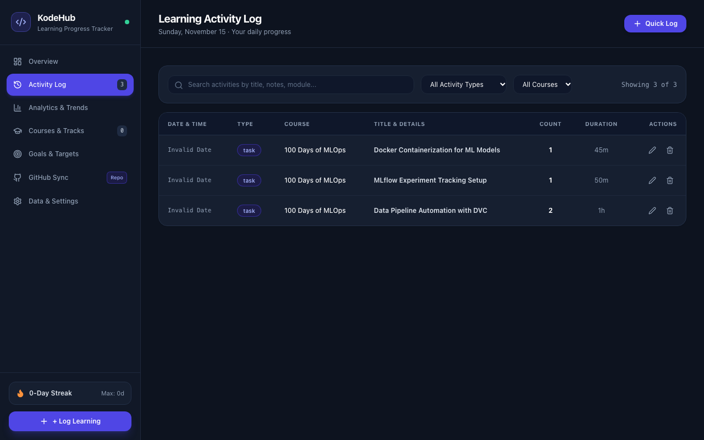
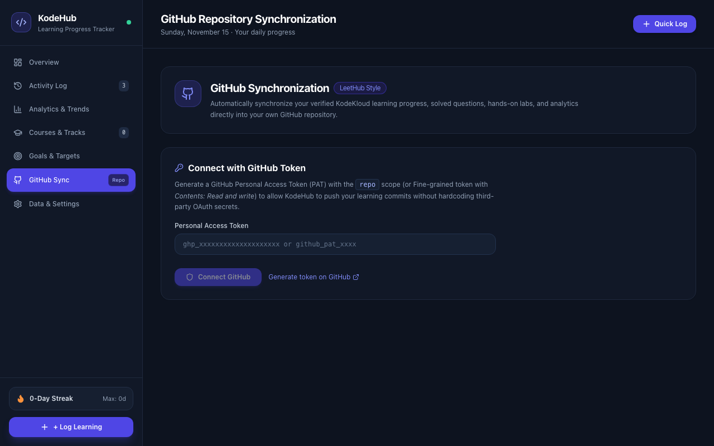

# 🚀 KodeHub

> **Track Your Learning. Measure Your Progress. Sync Directly to GitHub.**

KodeHub is a Chrome Extension built for KodeKloud learners who want to track their learning journey, monitor daily achievements, visualize progress and automatically maintain a learning portfolio on GitHub.

It combines real-time course progress tracking, learning analytics, activity history and LeetHub-style GitHub synchronization in one lightweight developer tool.

<p align="center">
  
</p>

<p align="center">
  <a href="https://github.com/NishantJLU/kodehub">
    
  </a>
  
  
  
</p>

---

## 📖 Table of Contents
- [Overview](#-overview)
- [Screenshots](#-screenshots)
- [Features](#-features)
- [How It Works](#-how-it-works)
- [GitHub Integration](#-github-integration-setup)
- [Installation](#-installation)
- [Project Structure](#-project-structure)
- [Technology Stack](#-technology-stack)
- [Testing](#-testing)
- [Privacy and Data Handling](#-privacy-and-data-handling)
- [Roadmap](#-roadmap)
- [Contributing](#-contributing)
- [License](#-license)
- [Author](#-author)

---

## 🌟 Overview
Learning platforms provide course completion statistics, but maintaining a consistent record of daily learning activity and achievements across multiple courses can be difficult.

KodeHub addresses this by automatically tracking learning progress on KodeKloud Engineer and transforming it into structured, measurable learning analytics.

Whether you’re working through **100 Days of MLOps**, **100 Days of DevOps** or **Cloud certifications**, KodeHub helps you understand:
- How many tasks you’ve completed.
- How much progress you’ve made today.
- How consistently you’ve been learning.
- Which courses you’re actively working on.
- How your learning activity changes over time.

It also synchronizes your progress with GitHub, allowing you to maintain a structured and accessible record of your learning journey.

**Supported platform**: [KodeKloud Engineer](https://engineer.kodekloud.com/practice)

---

## 📸 Screenshots

### 1. Extension Popup
A quick overview of daily learning activity, completed tasks, daily goals, learning time and weekly progress.
<p align="center">
  
</p>

### 2. Full-Screen Dashboard
A detailed learning dashboard featuring activity history, analytics, learning trends and progress visualization.
<p align="center">
  
</p>

### 3. Learning Analytics
Visualize your learning consistency through contribution heatmaps, weekly activity charts, course distribution and learning streaks.
<p align="center">
  
</p>

### 4. GitHub Integration
Connect your GitHub account, select a destination repository and synchronize your learning progress automatically.
<p align="center">
  
</p>

### 5. GitHub Learning Repository
Maintain an organized GitHub learning portfolio with course-wise progress, activity records and analytics.
<p align="center">
  
</p>

---

## ✨ Features

### 1. Dynamic KodeKloud Course Tracking
Automatically discovers and extracts course progress from the KodeKloud Engineer practice page.
- **Dynamic Course Discovery**: Discovers any visible track without hardcoded course name lists.
- **Structured DOM & Line Scanning**: Analyzes card containers with contextual line-scan fallbacks.
- **Multi-Course Recognition**: Supports multiple active, zero-progress, and collapsed courses on the same page.
- **Generic Button Filtering**: Filters action verbs (`Start`, `Continue`, `Resume`) and description sentences to capture true titles.
- **Accurate Metric Extraction**: Extracts completed, total, pending, unlocked, and locked counts.
- **Mathematical Validation**:
  $$\text{Pending Tasks} = \max(0, \text{Total Tasks} - \text{Completed Tasks})$$
  $$\text{Progress (\%)} = \frac{\text{Completed Tasks}}{\text{Total Tasks}} \times 100$$
  *Example*: `100 Days of MLOps` ($100$ total, $17$ completed $\implies 83$ pending, $17\%$).

### 2. Reliable Synchronization Engine
KodeHub separates local progress synchronization from GitHub uploads.

#### Local Synchronization (<50ms)
- Extracts course information from the active KodeKloud page.
- Compares current progress against previously stored snapshots.
- Detects newly observed completions (deltas).
- Updates local Chrome storage and recalculates statistics.
- Updates popup badge and UI immediately without waiting on network delays.

#### Background GitHub Synchronization
- Runs independently of local synchronization.
- Uploads validated learning progress asynchronously.
- Handles existing GitHub files using SHA-based conditional updates.
- Prevents duplicate or empty commits when data is unchanged.
- Recovers gracefully from network timeouts and GitHub API rate limits.

*The initial synchronization establishes an authentic baseline rather than fabricating past completion dates.*

### 3. Daily Learning Analytics
Monitor your daily learning activity through dedicated metric cards:

| Metric | Description |
| :--- | :--- |
| **Tasks Completed** | Verified tasks completed today |
| **Labs Completed** | Recorded hands-on lab activity |
| **Lessons Completed** | Recorded lesson and topic activity |
| **Learning Time** | Tracked study duration |

**Additional capabilities:**
- Customizable daily learning target.
- Daily completion progress bar.
- Verified activity tracking.
- Historical activity records.

### 4. Learning Streaks and Activity Heatmap
Understand your learning consistency through visual analytics:
- Current learning streak.
- Longest learning streak.
- Weekly activity distribution (Mon–Sun).
- 16-week GitHub-style contribution heatmap with 5 activity intensity levels.
- Course-wise activity distribution.
- Daily, weekly and monthly learning summaries.

### 5. Full-Screen Learning Dashboard
KodeHub includes a dedicated dashboard for managing and analyzing your learning activity:
- **Focus Study Timer**: Pomodoro-style study timer, customizable session durations, automatic session logging.
- **Activity Management**: Searchable activity history, filter by activity type or course, search by title and notes, edit records, delete with undo support.
- **Analytics & Trends**: Recharts weekly bar charts, learning contribution heatmap, course distribution breakdown.
- **Data Management**: Full JSON backup export/import, CSV activity export, data reset controls.

### 6. LeetHub-Style GitHub Integration
KodeHub automatically maintains a separate GitHub repository for your KodeKloud learning progress:
- GitHub Personal Access Token (classic or fine-grained) authentication.
- Display connected GitHub account username and avatar.
- Select an existing repository or create a new public/private repository in one click.
- Automatic background synchronization on sync or manual push button.
- SHA-based file updates avoiding duplicate commits.
- Structured course-wise repository generation.

**Repository Hierarchy:**
```text
kodekloud-progress/
│
├── README.md
│
├── Courses/
│   ├── 100-Days-of-MLOps/
│   │   ├── README.md
│   │   ├── progress.json
│   │   ├── Tasks/
│   │   └── Activity/
│   │       ├── daily-progress.json
│   │       └── activity-log.json
│   │
│   ├── 100-Days-of-DevOps/
│   │   └── ...
│   │
│   └── 100-Days-of-Cloud-Azure/
│       └── ...
│
└── Analytics/
    ├── overall-progress.json
    ├── weekly-summary.json
    └── monthly-summary.json
```
*Individual task folders are generated when verified task identities and completion information are available.*

**Example Progress Repository**: [NishantJLU/kodekloud-progress](https://github.com/NishantJLU/kodekloud-progress)

---

## ⚙️ How It Works

### Architecture Diagram
```text
KodeKloud Engineer
       │
       ▼
Active Practice Page
       │
       ▼
Content Script (IIFE)
       │
       ▼
Dynamic Course Extraction & Validation
       │
       ▼
Background Service Worker (MV3)
       │
   ┌───┴───┐
   │       │
   ▼       ▼ (Async Decoupled)
Local    GitHub
Storage   REST API
   │       │
   ▼       ▼
Analytics Progress Files
   │       │
   ▼       ▼
Popup UI GitHub Repository
   │
   ▼
Full Dashboard
```

### Synchronization Workflow

#### Phase A — Local Synchronization
1. Detect active KodeKloud tab (`*://*.kodekloud.com/*`).
2. Verify content-script availability with `PING` (inject dynamically if needed).
3. Extract visible course cards via dual-strategy DOM and line scanning.
4. Validate progress numbers and reject button labels.
5. Compare against stored snapshots and calculate newly observed completions.
6. Update Chrome local storage and browser action badge.
7. Return local synchronization result to popup immediately.

#### Phase B — GitHub Synchronization
1. Check GitHub connection configuration.
2. Read validated local progress and course records.
3. Generate repository markdown and JSON files.
4. Compare existing GitHub files using SHA values.
5. Commit only modified files with informative commit messages.
6. Record commit SHA and update synchronization history.

*Local synchronization and GitHub uploads operate independently; a GitHub network delay does not invalidate successfully stored local progress.*

---

## 📥 Installation

You can install KodeHub locally using the production build.

### Prerequisites
- Google Chrome or Brave Browser.
- Node.js v18 or later.
- npm.
- A GitHub account (optional, for GitHub cloud synchronization).

### Step 1 — Clone the Repository
```bash
git clone https://github.com/NishantJLU/kodehub.git
cd kodehub
```

### Step 2 — Install Dependencies
```bash
npm install
```

### Step 3 — Build the Extension
```bash
npm run build
```
The production build compiles the extension into:
```text
dist/
```

### Step 4 — Load the Extension
1. Open Google Chrome or Brave.
2. Navigate to `chrome://extensions/` (or `brave://extensions/`).
3. Enable **Developer mode** in the top right.
4. Click **Load unpacked**.
5. Select the `dist/` directory inside `kodehub`.
6. Pin **KodeHub** to your browser toolbar.

### Step 5 — Start Using KodeHub
1. Open [KodeKloud Engineer Practice](https://engineer.kodekloud.com/practice).
2. Wait for course cards to load.
3. Click the **KodeHub** extension icon.
4. Click **Sync**.
5. Review your daily progress, metrics, and learning statistics.

---

## 🔗 GitHub Integration Setup

GitHub integration is optional. To synchronize your learning progress with GitHub:

### Step 1 — Generate a Personal Access Token
Visit [GitHub Personal Access Tokens](https://github.com/settings/tokens) (or [Fine-Grained Tokens](https://github.com/settings/personal-access-tokens)):
- For a **Fine-grained token**:
  - **Repository access**: Only select your progress repository.
  - **Repository permissions**: `Contents` (Read and write), `Metadata` (Read-only).
- For a **Classic token**:
  - Select the `repo` scope.

### Step 2 — Connect GitHub
1. Open the KodeHub full-screen dashboard (click Dashboard in the popup).
2. Navigate to **GitHub Integration** in the sidebar.
3. Paste your Personal Access Token and click **Connect**.
4. Verify your connected GitHub username and avatar.

### Step 3 — Select a Repository
- Select an existing repository from your account (e.g. `kodekloud-progress`), OR
- Enter a name to create a new repository directly from the dashboard.
- Choose Public or Private visibility.

### Step 4 — Enable Automatic Synchronization
- Toggle **Automatic Sync** on to push progress in the background after each successful local synchronization.
- You can also click the manual **Push** button at any time.

> **Security Note**: Use a least-privilege token, never commit tokens to version control, and revoke any token that is accidentally exposed.

---

## 📁 Project Structure

```text
kodehub/
│
├── public/
│   ├── manifest.json          # Chrome Extension Manifest V3 configuration
│   └── icons/                 # Extension toolbar and store icons
│
├── src/
│   ├── background/            # Manifest V3 service worker & sync coordination
│   ├── content/               # Resilient DOM extraction & validation content script
│   ├── popup/                 # Quick popup application & stat widgets
│   ├── dashboard/             # Full-page analytics dashboard
│   ├── components/            # Reusable UI widgets, timer & modals
│   ├── services/              # Storage, sync engine, and GitHub REST API client
│   ├── utils/                 # Progress calculations, streak calculator & date utilities
│   └── types/                 # TypeScript type definitions & interfaces
│
├── tests/                     # 55 automated unit and integration tests (Vitest)
│
├── assets/
│   └── screenshots/           # Extension interface preview screenshots
│
├── dashboard.html             # Dashboard entry HTML
├── popup.html                 # Popup entry HTML
├── package.json
├── vite.config.ts             # Multi-target Vite and Rollup bundler configuration
├── README.md
└── LICENSE                    # MIT License
```

---

## 🛠️ Technology Stack

| Category | Technology |
| :--- | :--- |
| **Extension Framework** | Chrome Extension Manifest V3 |
| **Build Tool** | Vite |
| **Programming Language** | TypeScript |
| **Frontend** | React 18 |
| **Styling** | Tailwind CSS |
| **Icons** | Lucide React |
| **Data Visualization** | Recharts, SVG Heatmaps |
| **Local Storage** | Chrome Storage API (`chrome.storage.local`) |
| **GitHub Integration** | GitHub REST API (v3) |
| **Testing** | Vitest, JSDOM |

---

## 🧪 Testing

KodeHub includes an automated test suite with **55 unit and integration tests** covering:
- Mathematical boundary conditions and metric separation.
- Dynamic multi-course discovery and line-scan fallbacks.
- Collapsed course card handling.
- Button label (`Start`, `Continue`, `Resume`) and description filtering.
- Streak and weekly distribution calculations.
- Manifest V3 message listeners, timeouts, and mutex locks.
- LeetHub-style GitHub tree generation and idempotent updates.

### Run Tests
```bash
npm test
```

### Build Production Extension
```bash
npm run build
```

---

## 🔐 Privacy and Data Handling

KodeHub is designed to keep learning progress under the user’s control:
- Learning records and track snapshots are stored locally in your browser using `chrome.storage.local`.
- GitHub synchronization is completely optional.
- Progress is uploaded solely to the repository explicitly selected by the user.
- Authentication uses a user-provided Personal Access Token; tokens are stored in local extension storage.
- The extension does not transmit data to any third-party analytics services or private backend servers.
- Existing progress and snapshots are strictly preserved if a synchronization operation encounters an error.

---

## 🗺️ Roadmap

- [ ] Chrome Web Store publication.
- [ ] Additional KodeKloud learning analytics and track comparisons.
- [ ] More detailed course-level activity and milestone insights.
- [ ] Enhanced historical progress charts and exportable PDF summaries.
- [ ] Improved task-level tracking where supported by the platform.
- [ ] Additional learning-platform integrations.
- [ ] Advanced GitHub learning portfolio badges and interactive widgets.

---

## 🤝 Contributing

Contributions, bug reports, and feature suggestions are welcome!

1. Fork the repository.
2. Create a feature branch (`git checkout -b feature/new-feature`).
3. Commit your changes (`git commit -m 'feat: add new feature'`).
4. Run the test suite (`npm test`).
5. Push to the branch (`git push origin feature/new-feature`).
6. Open a Pull Request.

*Please never include authentication tokens or sensitive credentials in pull requests or issue reports.*

---

## 📄 License

KodeHub is distributed under the **MIT License**.  
See the [LICENSE](LICENSE) file for details.

---

## 👨‍💻 Author

**Nishant Singh**  
B.Tech Computer Science & Engineering  
GitHub: [@NishantJLU](https://github.com/NishantJLU)  
LinkedIn: [Nishant Singh](https://www.linkedin.com/in/nishantsingh-dev/)  

### Project Links
- Source Code: [NishantJLU/kodehub](https://github.com/NishantJLU/kodehub)
- Learning Progress: [NishantJLU/kodekloud-progress](https://github.com/NishantJLU/kodekloud-progress)

---

<p align="center">
  <b>Built to make learning measurable, consistent and visible.</b><br>
  ⭐ If you find KodeHub useful, consider giving the repository a star!
</p>
