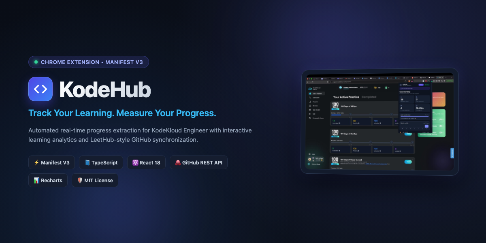
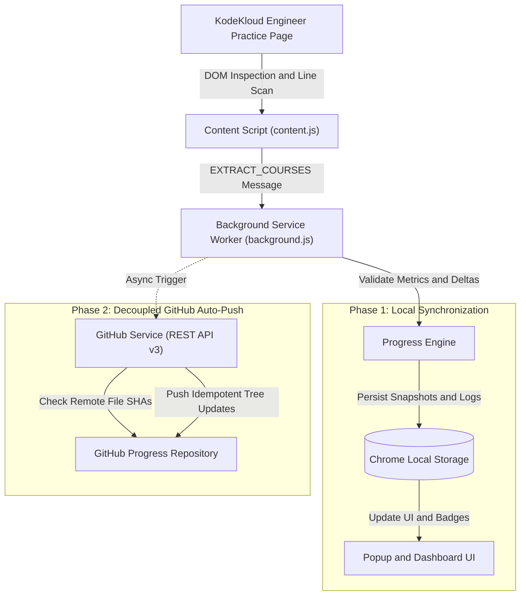

# 🚀 KodeHub

> **Track Your Learning. Measure Your Progress. Sync Directly to GitHub.**

KodeHub is a lightweight Chrome Extension built for [KodeKloud Engineer](https://engineer.kodekloud.com/practice) learners who want to track their daily learning journey, monitor hands-on achievements, visualize progress analytics, and automatically maintain a structured learning portfolio on GitHub.

It combines real-time course progress extraction, daily habit tracking, learning analytics, and LeetHub-style GitHub synchronization in one unified developer tool.

<p align="center">
  
</p>

<p align="center">
  <a href="https://github.com/NishantJLU/kodehub">
    
  </a>
  
  
  
  
  
  <a href="LICENSE">
    
  </a>
</p>

---

## 📖 Table of Contents

- [Overview](#overview)
- [Demonstration](#demonstration)
- [Features](#features)
- [Architecture](#architecture)
- [How It Works](#how-it-works)
- [Installation](#installation)
- [GitHub Integration](#github-integration)
- [Project Structure](#project-structure)
- [Technology Stack](#technology-stack)
- [Testing](#testing)
- [Privacy and Security](#privacy-and-security)
- [Roadmap](#roadmap)
- [Contributing](#contributing)
- [License](#license)
- [Author](#author)

---

## <a id="overview"></a>🌟 Overview

Online learning platforms provide static completion numbers, but tracking consistent daily study habits, measuring incremental progress across multiple tracks, and showcasing practical labs on a developer portfolio is often challenging.

**KodeHub** bridges this gap for KodeKloud Engineer learners by transforming real-time page data into actionable learning analytics and maintaining an automated, version-controlled GitHub record of every completed task.

### Why KodeHub?
- **Zero Manual Logging**: Directly parses active tracks from the KodeKloud Engineer interface.
- **Accurate Habit Metrics**: Computes true daily task completions, streaks, and focus study hours.
- **Automated GitHub Portfolio**: Keeps a clean, LeetHub-style repository containing task progress, activity history, and markdown documentation.
- **Local-First & Secure**: Operates directly in your browser without intermediate servers, third-party analytics, or credential harvesting.

**Supported Platform**: [KodeKloud Engineer Practice](https://engineer.kodekloud.com/practice)

---

## <a id="demonstration"></a>🎥 Demonstration

> [!NOTE]
> An interactive walkthrough GIF (`assets/screenshots/kodehub-demo.gif`) is scheduled for the upcoming release. Follow the recording procedure below if you wish to contribute a recording.

<details>
<summary><b>Recording Specification for <code>assets/screenshots/kodehub-demo.gif</code></b></summary>

To maintain visual consistency across project documentation, demo recordings should follow these steps:
1. Open the [KodeKloud Practice Page](https://engineer.kodekloud.com/practice) in Chrome or Brave.
2. Click the **KodeHub** icon in the browser toolbar to open the popup.
3. Click the **Sync** button to demonstrate dynamic course discovery and progress extraction.
4. Highlight the updated daily stats, completion badges, and streak increment.
5. Click **Open Full Dashboard** and navigate to the **GitHub** tab.
6. Trigger a sync and show the newly created commit on the connected GitHub progress repository.
</details>

---

## <a id="features"></a>✨ Features

### A. Dynamic Course Tracking
- **Zero Hardcoding**: Dynamically discovers any active course card on the page without predefined course lists.
- **Multi-Course Recognition**: Concurrently extracts progress for active courses (e.g., *100 Days of MLOps*, *100 Days of DevOps*, *100 Days of Cloud Azure*).
- **Dual-Layer Extraction**: Uses structured DOM card queries with contextual line-scan fallbacks to read dynamically rendered or collapsed course elements.
- **Label & Noise Filtering**: Accurately differentiates actual course titles from button labels (`Start`, `Continue`, `Resume`) and descriptive text.
- **Mathematical Integrity**:
  $$\text{Pending Tasks} = \max(0, \text{Total Tasks} - \text{Completed Tasks})$$
  $$\text{Progress (\%)} = \left(\frac{\text{Completed Tasks}}{\text{Total Tasks}}\right) \times 100$$
  *Example*: `100 Days of MLOps` ($17/100 \implies 83\text{ pending}, 17.0\%$).

### B. Decoupled Synchronization Engine
- **Independent Local Sync**: Local synchronization executes immediately against `chrome.storage.local`, updating popup badges and interface metrics without waiting for external API latency.
- **Background GitHub Auto-Push**: Once local progress is persisted, the background service worker initiates an asynchronous push to the GitHub REST API.
- **Delta & Baseline Detection**: Initial synchronization establishes an authentic baseline to avoid attributing historical completions to today's date. Subsequent syncs calculate true positive deltas.
- **SHA-Based Conditional Updates**: Queries remote file SHAs before writing, preventing duplicate commits when course data has not changed.
- **Resilient Error Recovery**: Network drops or GitHub rate limits do not disrupt local storage or existing progress records.

### C. Learning Analytics
- **Daily Progress Metrics**: Tracks verified tasks completed today, hands-on labs, lesson modules, and total study duration.
- **Dynamic Goal Progress**: Configurable daily targets with visual completion percentage rings.
- **Streak Engine**: Tracks both current streak and longest historical streak, with support for timezone-accurate calendar date comparisons.
- **Weekly Distribution**: Bar chart breakdown of daily task output from Monday through Sunday.
- **Contribution Heatmap**: 16-week GitHub-style heatmap displaying daily study density across 5 activity levels.

### D. Full-Screen Dashboard
- **Pomodoro Study Timer**: Built-in focus session timer with customizable intervals and automatic study log generation.
- **Activity Management**: Search activities by keyword, filter by track or type, edit existing records, and delete entries with a 6-second undo toast.
- **Data Portability**: One-click JSON backup export and import, plus CSV export for spreadsheet analysis.
- **Track Explorer**: Visual progress bars and milestone indicators for every enrolled course.

### E. LeetHub-Style GitHub Organization
- **Personal Access Token Support**: Works securely with fine-grained personal access tokens or classic tokens.
- **Repository Management**: Select an existing repository or create a new public/private repository directly from the extension UI.
- **Structured File Hierarchy**: Organizes learning records into course directories and high-level analytical summaries.

```text
kodekloud-progress/
│
├── README.md
│
├── Courses/
│   ├── 100-Days-of-MLOps/
│   │   ├── README.md
│   │   ├── progress.json
│   │   └── Activity/
│   │       ├── daily-progress.json
│   │       └── activity-log.json
│   │
│   ├── 100-Days-of-DevOps/
│   │   └── ...
│   │
│   └── 100-Days-of-Cloud-Azure/
│       └── ...
│
└── Analytics/
    ├── overall-progress.json
    ├── weekly-summary.json
    └── monthly-summary.json
```

---

## <a id="architecture"></a>🏛️ Architecture

KodeHub adheres to Google Chrome's Manifest V3 architecture, employing an isolated content script, a background service worker, and local-first storage.



---

## <a id="how-it-works"></a>⚙️ How It Works

KodeHub processes learning data in two strictly decoupled phases to ensure optimal user experience and resilience against network bottlenecks:

### Phase 1: Local Synchronization
1. The user clicks **Sync** inside the popup or triggers automatic tab detection.
2. The background worker checks for an active tab matching `engineer.kodekloud.com/practice`.
3. The content script inspects the DOM using container queries and line-scanning fallbacks, extracting active tracks, completed tasks, and total tasks.
4. The background worker validates the numbers ($Total \ge Completed \ge 0$), compares them with stored baselines, and calculates positive task deltas.
5. Daily activity logs and track snapshots are committed to `chrome.storage.local`.
6. The popup receives immediate confirmation and updates its display without waiting for network calls.

### Phase 2: Asynchronous GitHub Auto-Push
1. If GitHub synchronization is enabled in settings, the background worker schedules an asynchronous upload task.
2. The service worker connects to GitHub's REST API using the user's securely stored token.
3. For each active track, it fetches existing file SHAs to determine whether remote updates are necessary.
4. If deltas are present, it writes course-specific `README.md`, `progress.json`, and analytical summaries.
5. If no values changed, the push is safely skipped, avoiding redundant commits in the user's Git history.

---

## <a id="installation"></a>📥 Installation & Setup

### Prerequisites
- Google Chrome (v102+) or Brave Browser (v1.40+)
- [Node.js](https://nodejs.org/) (v18.0.0 or higher)
- [npm](https://www.npmjs.com/) (v9.0.0 or higher)
- [Git](https://git-scm.com/)

### Step 1: Clone Repository
```bash
git clone https://github.com/NishantJLU/kodehub.git
cd kodehub
```

### Step 2: Install Dependencies
```bash
npm install
```

### Step 3: Build the Extension
```bash
npm run build
```
This builds the production assets into the `dist/` directory, including the self-contained `content.js` (IIFE) and `background.js` (ESM).

### Step 4: Load Extension into Browser
#### For Google Chrome:
1. Open Google Chrome and navigate to `chrome://extensions/`.
2. Enable **Developer mode** using the toggle in the top-right corner.
3. Click the **Load unpacked** button.
4. Select the `dist/` directory inside your cloned `kodehub` repository.
5. Pin **KodeHub** to your browser toolbar for quick access.

#### For Brave Browser:
1. Open Brave and navigate to `brave://extensions/`.
2. Enable **Developer mode** in the top-right corner.
3. Click **Load unpacked** and select the `dist/` folder.
4. Pin the extension to your toolbar.

### Step 5: Start Tracking
1. Open [KodeKloud Engineer Practice](https://engineer.kodekloud.com/practice).
2. Click the **KodeHub** icon in your toolbar.
3. Click **Sync** to capture your current learning state.

---

### 🔧 Troubleshooting Guide

| Issue | Cause | Solution |
| :--- | :--- | :--- |
| **Extension does not load in Chrome** | Loaded wrong folder | Ensure you select the compiled `dist/` directory, not the project root. |
| **`npm run build` fails** | Node version incompatibility | Ensure Node.js $\ge$ 18.0.0 is active (`node -v`). Run `npm clean-install` if dependencies are corrupted. |
| **"Sync Failed: Unable to read practice courses"** | Page not loaded or wrong URL | Ensure you are on `engineer.kodekloud.com/practice`. Wait for course cards to render, then re-click Sync. |
| **GitHub sync fails / Bad credentials** | Invalid or expired token | Generate a new GitHub Personal Access Token with `repo` or `Contents: Read and Write` permissions and reconnect. |
| **"Timed out waiting for background synchronization"** | Service worker inactive | Click extension reload on `chrome://extensions/` and reopen the popup. |

---

## <a id="github-integration"></a>🔗 GitHub Integration Setup

Synchronizing your learning progress to GitHub is completely optional.

### Step 1: Generate a Personal Access Token
1. Go to [GitHub Personal Access Tokens](https://github.com/settings/tokens).
2. Choose **Fine-grained tokens** (recommended) or **Tokens (classic)**.

#### Recommended: Fine-Grained Token (Least Privilege)
- **Token name**: `KodeHub Progress Tracker`
- **Expiration**: 90 days or custom
- **Repository access**: *Only select repositories* $\rightarrow$ Choose your progress repository (e.g., `kodekloud-progress`)
- **Permissions**:
  - `Contents`: **Read and Write** (allows committing progress files and READMEs)
  - `Metadata`: **Read-only** (default required permission)

#### Alternative: Classic Token
- Select the `repo` scope (Full control of private repositories).

### Step 2: Connect via KodeHub Dashboard
1. Click the KodeHub extension icon $\rightarrow$ Click **Full Dashboard** (or right-click $\rightarrow$ **Options**).
2. Navigate to the **GitHub** tab in the sidebar.
3. Paste your token and click **Connect Account**.
4. Select an existing repository from the dropdown or click **Create Repository** to initialize a new public or private repo.
5. Enable **Auto-Sync** for hands-free synchronization on every local sync.

> [!WARNING]
> **Token Security Best Practices**:
> - Never commit personal access tokens to version control.
> - KodeHub stores tokens exclusively in your browser's private `chrome.storage.local`.
> - If you ever suspect a token has been exposed, revoke it immediately at [GitHub Token Settings](https://github.com/settings/tokens).

---

## <a id="project-structure"></a>📂 Project Structure

```text
kodehub/
├── assets/                          # Static assets and screenshot documentation
│   ├── kodehub-social-preview.png   # 1200x600 project social preview
│   └── screenshots/                 # Verified genuine application screenshots
│       ├── popup-dashboard.png      # Popup dashboard screenshot
│       ├── full-dashboard.png       # Main overview dashboard screenshot
│       ├── activity-history.png     # Activity history and filtering screenshot
│       ├── github-integration.png   # GitHub setup view screenshot
│       └── github-progress.png      # Public progress repository screenshot
│
├── public/                          # Extension static distribution files
│   ├── icons/                       # Extension action icons (16px, 48px, 128px)
│   └── manifest.json                # Chrome Extension Manifest V3 configuration
│
├── src/                             # Application source code
│   ├── background/
│   │   └── index.ts                 # Service worker: message router, sync locks, storage
│   ├── content/
│   │   └── kodekloud.ts             # Content script: DOM queries, line scanning, card parsing
│   ├── popup/                       # Lightweight toolbar popup application
│   │   ├── main.tsx                 # Popup entry point
│   │   └── PopupApp.tsx             # Popup React component
│   ├── dashboard/                   # Comprehensive full-screen analytics dashboard
│   │   ├── main.tsx                 # Dashboard entry point
│   │   └── DashboardApp.tsx         # Dashboard React component with tab router
│   ├── components/                  # Reusable React components
│   │   ├── ActivityLogModal.tsx     # Manual activity logging modal
│   │   ├── EditActivityModal.tsx    # Activity editing modal
│   │   ├── GitHubIntegrationView.tsx# GitHub token connection & repo management view
│   │   ├── HeatmapGrid.tsx          # 16-week SVG contribution matrix
│   │   └── StudyTimer.tsx           # Focus study timer component
│   ├── services/                    # Business logic and external communication
│   │   ├── github.service.ts        # GitHub REST API client (SHA resolution, commits)
│   │   ├── storage.service.ts       # Chrome storage wrapper with local fallback
│   │   └── sync.service.ts          # Synchronous delta engine & baseline tracker
│   ├── utils/                       # Algorithmic utilities & formatters
│   │   ├── analyticsCalculator.ts   # Daily, weekly, and heatmap aggregations
│   │   ├── dateUtils.ts             # Timezone-safe date formatters and ISO helpers
│   │   ├── progressCalculator.ts    # Mathematical course metric validation
│   │   └── streakCalculator.ts      # Continuous streak calculation logic
│   └── types/
│       └── index.ts                 # Core TypeScript type definitions
│
├── tests/                           # Comprehensive test suite (Vitest + JSDOM)
│   ├── calculations.test.ts         # Math and streak unit tests (12 tests)
│   ├── content-script.test.ts       # DOM discovery & parsing tests (11 tests)
│   ├── github.test.ts               # GitHub API integration & error tests (14 tests)
│   ├── storage-and-export.test.ts   # Local storage and backup export tests (5 tests)
│   └── sync.test.ts                 # Synchronization engine & delta tests (13 tests)
│
├── dashboard.html                   # HTML harness for dashboard page
├── popup.html                       # HTML harness for popup page
├── package.json                     # Project manifest, dependencies, and scripts
├── tailwind.config.js               # Tailwind CSS theme configuration
├── tsconfig.json                    # TypeScript compiler options
├── vite.config.ts                   # Vite bundler configuration & esbuild plugins
└── LICENSE                          # MIT License specification
```

---

## <a id="technology-stack"></a>💻 Technology Stack

| Category | Technology | Version | Purpose |
| :--- | :--- | :--- | :--- |
| **Extension Framework** | Chrome Manifest V3 | 3.0 | Modern extension security, service workers, declarative content scripts |
| **Language** | TypeScript | ^5.7.3 | Strict static typing, type definitions, robust interfaces |
| **Frontend Framework** | React | ^18.3.1 | Modular reactive UI components for popup and dashboard |
| **Bundler & Tooling** | Vite / esbuild | ^6.1.0 | Fast HMR development and dual IIFE/ESM production packaging |
| **Styling** | Tailwind CSS | ^3.4.17 | Responsive dark-mode styling and utility-first design |
| **Icons** | Lucide React | ^0.475.0 | Clean, accessible developer iconography |
| **Data Visualization** | Recharts | ^2.15.1 | Composable SVG analytics and weekly activity bar charts |
| **Local Storage** | Chrome Storage API | MV3 | Asynchronous, persistent local data store with memory fallback |
| **API Integration** | GitHub REST API | v3 | Idempotent SHA-based Git commits and repository creation |
| **Testing Framework** | Vitest | ^3.0.5 | High-performance unit and integration testing |
| **DOM Environment** | JSDOM | Built-in | Simulated browser DOM environment for content script testing |

---

## <a id="testing"></a>🧪 Testing & Verification

KodeHub maintains a test suite of **55 automated tests** across 5 test suites covering parsing, delta calculations, storage, and GitHub integration.

### Test Breakdown
- `tests/content-script.test.ts` (11 tests): Multi-course discovery, dynamic line-scan fallback, collapsed card handling, and button noise filtering.
- `tests/calculations.test.ts` (12 tests): Mathematical formula validation, daily totals, streaks, and heatmap aggregations.
- `tests/sync.test.ts` (13 tests): Baseline initialization, delta computation, decoupled local sync speed, and mutex locks.
- `tests/github.test.ts` (14 tests): Tree formatting, SHA comparisons, rate-limiting handlers, and repository creation.
- `tests/storage-and-export.test.ts` (5 tests): Chrome storage transactions, JSON import/export, and CSV exports.

### Run Tests
```bash
npm test
```

### Production Build
```bash
npm run build
```

---

## <a id="privacy-and-security"></a>🔐 Privacy and Security

KodeHub is designed with a strict local-first, privacy-respecting architecture:
- **No Remote Telemetry**: The extension contains zero tracking pixels, telemetry probes, or third-party analytics scripts.
- **Local Persistence**: Learning records and course snapshots are stored exclusively in your browser's private `chrome.storage.local`.
- **Direct GitHub Communication**: GitHub API requests are dispatched directly from your browser to `api.github.com`. No intermediate backend proxies or third-party servers are involved.
- **Scoped Token Handling**: Personal Access Tokens are saved in secure local storage and used solely for authenticating requests to the GitHub repository you designate.
- **Read-Only Inspection**: Course progress extraction parses visibly rendered page text on KodeKloud Engineer without intercepting credentials, cookies, or internal platform tokens.

---

## <a id="roadmap"></a>🗺️ Roadmap

- [x] Chrome Manifest V3 migration and decoupled sync engine.
- [x] Multi-course dynamic discovery with line-scan fallback.
- [x] LeetHub-style GitHub repository structure (`Courses/` and `Analytics/`).
- [x] Full-screen learning analytics dashboard with study timer.
- [x] Automated test suite with 55 passing Vitest tests.
- [ ] Chrome Web Store official release.
- [ ] Milestone badges and social shareable completion cards.
- [ ] Exportable PDF learning summaries.
- [ ] Support for additional cloud learning platforms.

---

## <a id="contributing"></a>🤝 Contributing

Contributions, bug reports, and feature requests are welcome!

1. **Fork the Repository**: Click the **Fork** button at the top right of [NishantJLU/kodehub](https://github.com/NishantJLU/kodehub).
2. **Clone your fork**:
   ```bash
   git clone https://github.com/<your-username>/kodehub.git
   cd kodehub
   ```
3. **Create a Feature Branch**:
   ```bash
   git checkout -b feature/amazing-feature
   ```
4. **Make Your Changes** and verify all tests pass:
   ```bash
   npm test
   npm run build
   ```
5. **Commit Your Changes**:
   ```bash
   git commit -m "feat: add amazing feature"
   ```
6. **Push to Your Branch**:
   ```bash
   git push origin feature/amazing-feature
   ```
7. **Open a Pull Request**: Submit your PR with a clear summary of modifications and test results.

---

## <a id="license"></a>📄 License

Distributed under the **MIT License**. See the [LICENSE](LICENSE) file for complete details.

```text
Copyright (c) 2026 Nishant Singh
```

---

## <a id="author"></a>👨‍💻 Author

**Nishant Singh**  
*B.Tech Computer Science & Engineering*

- **GitHub**: [@NishantJLU](https://github.com/NishantJLU)
- **LinkedIn**: [Nishant Singh](https://www.linkedin.com/in/nishantsingh-dev/)

### Project Repositories
- **Extension Source Code**: [NishantJLU/kodehub](https://github.com/NishantJLU/kodehub)
- **Learning Progress Repository**: [NishantJLU/kodekloud-progress](https://github.com/NishantJLU/kodekloud-progress)

---

<p align="center">
  <b>Built to make learning measurable, consistent, and visible.</b><br>
  ⭐ If you find KodeHub helpful, consider starring the repository!
</p>
